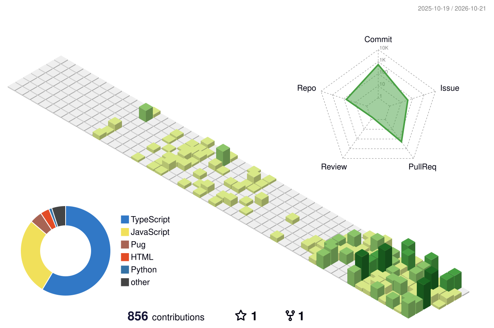

# namiyama814

Webアプリケーションや開発者向けツールを作っています。  
最近は **TypeScript・Cloudflare Workers・MCP** を使った開発に取り組んでいます。

## 技術スタック

Hono / MCP / WebRTC

## プロジェクト

- **Anzdrop** — ブラウザで利用できるファイル共有サービス（開発中）
- [**obsidian-mcp**](https://github.com/namiyama814/obsidian-mcp) — ObsidianのノートをChatGPTから操作するMCPサーバー
- [**crowdworks-cli**](https://github.com/namiyama814/crowdworks-cli) — クラウドワークスの案件を検索・比較するCLI / MCPサーバー
- [**switchbotMCP**](https://github.com/namiyama814/switchbotMCP) — SwitchBotを操作するMCPサーバー

## GitHubでの活動

<picture>
  <source media="(prefers-color-scheme: dark)" srcset="./profile-3d-contrib/profile-night-rainbow.svg" />
  
</picture>
