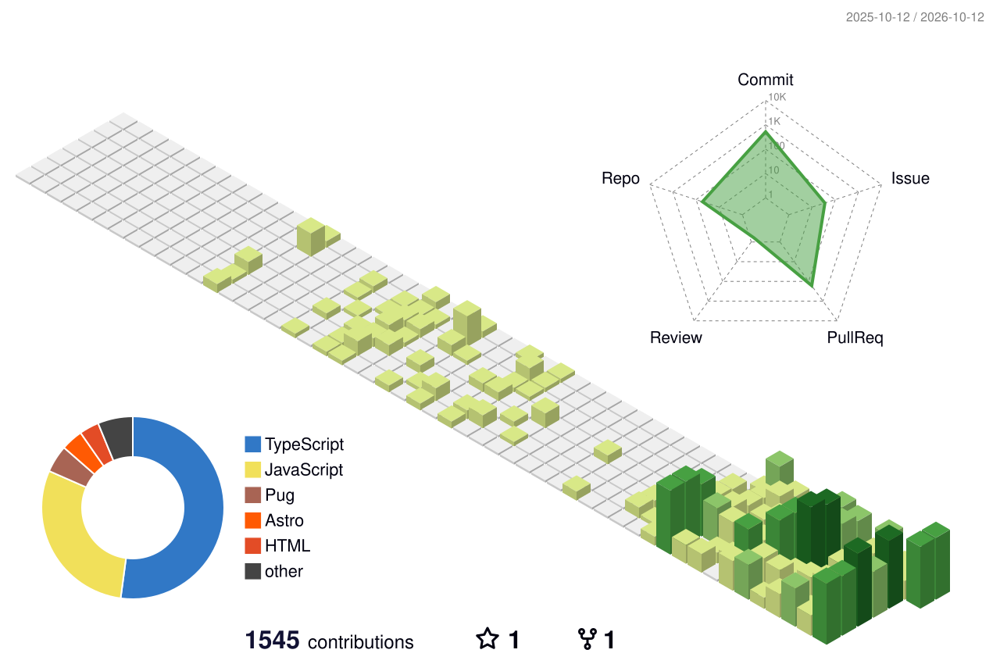

# Hey, I'm namiyama814 👋

**Web applications · Developer tools · Open source**

## About me

I enjoy building useful tools, experimenting with web technologies, and connecting services to AI assistants.

- Based in Japan
- Working on **Anzdrop**, a browser-based file-sharing service
- Interested in **TypeScript, Cloudflare Workers, MCP, and peer-to-peer technologies**
- Often turning small ideas into CLI tools, integrations, or web apps

## Tech stack

  

  
  
  

## My 3D contribution graph

  <picture>
    <source media="(prefers-color-scheme: dark)" srcset="./profile-3d-contrib/profile-night-rainbow.svg" />
    
  </picture>

Generated from my GitHub contributions and refreshed daily with GitHub Actions.

## GitHub activity

  
  

## Selected projects

| Project | What it does |
| --- | --- |
| **Anzdrop** | Browser-based file sharing, including an exploration of direct peer-to-peer transfers. |
| [**obsidian-mcp**](https://github.com/namiyama814/obsidian-mcp) | Remote MCP server for working with an Obsidian vault through GitHub. |
| [**crowdworks-cli**](https://github.com/namiyama814/crowdworks-cli) | TypeScript CLI and MCP server for discovering and reviewing CrowdWorks projects. |
| [**switchbotMCP**](https://github.com/namiyama814/switchbotMCP) | MCP server for controlling SwitchBot devices with Cloudflare Workers. |
| [**nlobby-cli**](https://github.com/namiyama814/nlobby-cli) | CLI and MCP interface for an online school portal. |

---

Always experimenting. More projects on <a href="https://github.com/namiyama814?tab=repositories">GitHub</a>.

